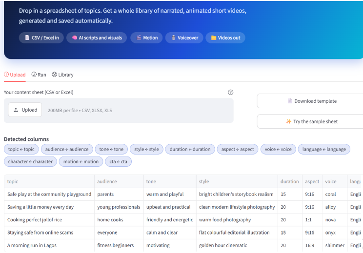
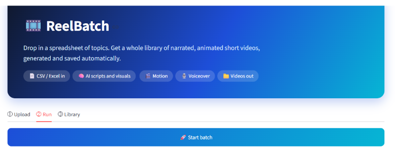
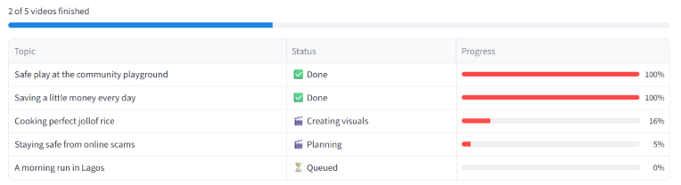
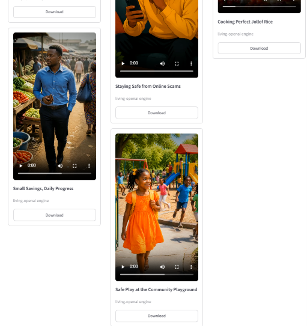
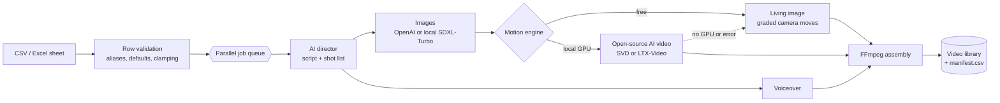

<div align="center">

# Producing multiple ai videos in batches

### Turn a spreadsheet of topics into a library of narrated, animated short videos.


</div>

---

## 🎬 Demo

Five rows in one sheet, five finished videos out. Each one has its own aspect ratio, length, tone and voice, all set from the spreadsheet.

### 1. Safe play at the community playground
*Vertical 9:16 · 15 seconds · warm and playful · voice: coral*
https://github.com/user-attachments/assets/ac726a3a-f1a9-4d2d-85a1-be68e51db587


### 2. Saving a little money every day
*Vertical 9:16 · 20 seconds · upbeat and practical · voice: alloy*
https://github.com/user-attachments/assets/5d14d75b-c787-4ca3-a001-bbe015547c78

### 3. Cooking perfect jollof rice
*Square 1:1 · 20 seconds · friendly and energetic · voice: nova*
https://github.com/user-attachments/assets/b9efea73-ebc7-4924-8fa9-40f9744ea359


### 4. Staying safe from online scams
*Vertical 9:16 · 15 seconds · calm and clear · voice: onyx*
https://github.com/user-attachments/assets/0aa763b5-9ab5-4d15-a2e6-af1496a7bd90


### 5. A morning run in Lagos
*Widescreen 16:9 · 20 seconds · motivating · voice: shimmer*

https://github.com/user-attachments/assets/160e771e-6595-45e6-b9d8-248a0932fbfc
---

## 🖥️ The app in three steps

**① Upload.** Drop in a CSV or Excel sheet, or try the built-in sample. The app detects your columns and shows a preview of every row.



**② Run.** Press **Start batch**.



A live dashboard shows each video moving through planning, visuals, voiceover and rendering, and several are made in parallel.



**③ Library.** Finished videos land in a browsable library, each with a download button. You can also download a ZIP of everything.

<table>
  <tr>
    <td></td>
    <td></td>
  </tr>
</table>

---

## ✨ What it does

Fill in a CSV or Excel sheet, one row per video. ReelBatch writes the script, creates consistent visuals, records the voiceover, adds motion, edits everything together and saves the finished MP4s to a browsable library. No timeline editing, no per-video prompting.

| You provide | You get |
|---|---|
| `topic`, plus any optional columns | A finished MP4 per row, with subtitles (`.srt`) |
| One sheet with up to 25 rows | A live dashboard, a library of videos, and a CSV manifest of results |

## 🧭 How it works



## 🎥 Motion engines

| Engine | Motion | Runs on | Cost |
|---|---|---|---|
| 🪄 **Living image** | Graded, vignetted camera moves over each image (the camera moves, the people do not) | Any laptop | Free motion |
| 🧠 **Local AI video** | People and objects genuinely move, using open-source image-to-video models | Your own GPU or Google Colab | Free software, your GPU time |
| 🧪 **Demo mode** | Placeholder visuals, silent narration | Any laptop | Free, no keys needed |

The videos above were made with the **Living image** engine and OpenAI images (the library labels them `living-openai`).

**Local AI video models** (through Hugging Face [`diffusers`](https://github.com/huggingface/diffusers)):

| Model | How it behaves | Settings used |
|---|---|---|
| **LTX-Video** (`Lightricks/LTX-Video`) | Follows the shot's text motion prompt | 97 frames (8k+1) at 24 fps, sizes divisible by 32, VAE tiling, CPU offload |
| **Stable Video Diffusion XT** (`stabilityai/stable-video-diffusion-img2vid-xt`) | Animates the image by itself (ignores text) | 25 frames at 7 fps, fp16, chunked decoding to save VRAM |

Images can also be drawn locally with **SDXL-Turbo** (2 steps, no guidance) instead of OpenAI images. Scripts and voiceover still use the OpenAI API.

How the local engine is built: models load lazily on first use and are reused across shots, a lock keeps one generation on the GPU at a time, results are seeded per prompt for repeatability, and CUDA memory is cleared between clips. With no GPU or PyTorch, a clear error is raised once and every shot **falls back to the free engine automatically**, so a batch always finishes.


### Running on a GPU without owning one

Open [`notebooks/reelbatch_colab.ipynb`](notebooks/reelbatch_colab.ipynb) in Google Colab with a T4 GPU. It installs everything, takes your sheet, runs the headless CLI and downloads the videos. Colab's free GPU access is limited and not guaranteed, so start with 1-2 rows.

```bash
python -m core.cli sheet.csv --engine local --video-model ltx --images openai --workers 1
```

## 📄 The sheet

Only **`topic`** is required. Column names are matched flexibly (for example `title`, `subject` or `idea` all work for topic).

| Column | Example | Default |
|---|---|---|
| `topic` | Saving a little money every day | required |
| `audience` | young professionals | a general audience |
| `tone` | upbeat and practical | warm and engaging |
| `style` | warm food photography | cinematic, vibrant, realistic |
| `duration` | 20 (seconds, 10-30) | 20 |
| `aspect` | `9:16`, `1:1` or `16:9` | 9:16 |
| `voice` | coral, alloy, nova, onyx, shimmer | coral |
| `language` | English | English |
| `character` | Chidi, a 28-year-old man in a blue shirt | invented by the AI |
| `motion` | walking confidently through a busy market | natural movement |
| `cta` | Start your savings habit today | none |

A ready-made example lives in [`templates/sample.csv`](templates/sample.csv). It's the same sheet that produced the five videos in the demo.

## 🚀 Quick start

```bash
git clone https://github.com/Jaycobson/reelbatch.git
cd reelbatch
python -m venv .venv
.venv\Scripts\activate            # macOS/Linux: source .venv/bin/activate
pip install -r requirements.txt
copy .env.example .env            # macOS/Linux: cp .env.example .env
streamlit run app.py
```

1. Install [FFmpeg](https://ffmpeg.org/download.html) and make sure `ffmpeg` and `ffprobe` are on your PATH.
2. Add your `OPENAI_API_KEY` to `.env`.
3. In the app: **① Upload** a sheet, **② Run** the batch, **③ Library** to watch and download.

No keys yet? Choose **Demo mode** to run the whole pipeline with no API calls.

Optional local AI models: `pip install -r requirements-gpu.txt` (needs a GPU; the app shows whether one was detected).

## 🧱 Project structure

```
app.py                 Streamlit dashboard (upload, live run, library)
core/
  sheet.py             CSV/Excel parsing, flexible columns, validation, stable row ids
  providers.py         OpenAI (script, images, voice) and a no-API demo provider
  local_models.py      Open-source diffusers models: SDXL-Turbo, SVD-XT, LTX-Video
  engines.py           Builds the right engines for a run, environment checks
  cli.py               Headless runner (used by the Colab notebook)
  batch.py             Per-row pipeline, parallel runner, caching, manifest
  video.py             FFmpeg: camera moves, clip fitting, assembly, subtitles
  util.py              Retry with backoff
templates/sample.csv   Example sheet
notebooks/             Colab notebook for a free GPU
screenshots/           Images used in this README
tests/                 Parsing, pipeline, fallback, failure isolation, UI, local models (simulated GPU)
```

## 🛡️ Engineering notes

- **Failure isolation:** one bad row never stops the batch. Errors are shown per row and saved in the manifest.
- **Caching:** each row has a stable id built from its content and the chosen engine, so unchanged rows are reused instead of paid for twice.
- **Graceful degradation:** local AI video falls back to the free engine per shot when there is no GPU or a model error.
- **Retries:** API calls retry with backoff, except for client errors such as a bad key.
- **Live dashboard:** the batch runs on a background thread and the UI polls it, so the page stays responsive.
- **Tested end to end:** `pytest` runs the real pipeline in demo mode (including the Streamlit UI through `AppTest`), the fallback path and the failure path. CI runs lint and tests on every push.

```bash
pytest -q        # tests
ruff check .     # lint
```


## 🗺️ Roadmap

- More open-source motion models (Wan, CogVideoX) behind the same interface
- Character LoRAs and IP-Adapter for stronger consistency
- Open-source voice (Piper or Kokoro) so only the script needs an API
- Brand kits per row (logo, colours) and burned-in captions
- Scheduling and publishing to social platforms
- Google Sheets as an input source

---

<div align="center">Built with Python, Streamlit, FFmpeg and the OpenAI API.</div>
